# 🌾 CropDeal — Capgemini Final Project
### Enterprise B2B AgriTech Marketplace, Live Auction Floor & Supply Chain Logistics Platform

<p align="center">
  
  
  
  
  
  
  
  
  
  
  
  
</p>

---

## 📌 Executive Summary

**CropDeal** is an enterprise-grade, distributed B2B AgriTech e-commerce, live auction bidding, direct price bargaining, and supply chain logistics ecosystem developed as a **Capgemini Final Project**. 

Built with **16 Spring Boot microservices**, **Spring Cloud 2023**, and an **Angular 18+ Standalone responsive web client**, the platform eliminates exploitative agricultural middlemen by connecting **Farmers (Producers)** directly with **Dealers (Commercial Wholesale Buyers)**, **Logistics & Delivery Partners**, and **Platform Administrators**.

The system features **live Government of India Mandi price benchmarks (AGMARKNET / data.gov.in)**, **CQRS (Command Query Responsibility Segregation)** in catalog and auction domains, **distributed SAGA transaction orchestration**, **RabbitMQ event-driven asynchronous messaging**, **Resilience4j circuit breakers & retry mechanisms**, **Cloudinary cloud media infrastructure**, **Sarvam AI Agricultural LLM conversational advisory**, automated **Rule 46 CGST tax invoicing**, and **5-stage live logistics tracking**.

---

## 🏛️ System Architecture

CropDeal adheres to the **Database-per-Service** architectural pattern, guaranteeing complete domain autonomy, zero schema coupling, horizontal scalability, and resilience across the entire microservice ecosystem.

```mermaid
flowchart TD
    subgraph Client_Layer ["Client Layer"]
        UI["Angular 18+ Web Client (Port 4200)<br/>Role-Based Dashboards • Glassmorphism UI<br/>Indian Geo-Hierarchy • 5-Stage Live Tracking"]
    end

    subgraph Gateway_Mesh ["API Gateway & Discovery Mesh"]
        EUREKA["Netflix Eureka Registry (Port 8761)<br/>Dynamic Service Discovery"]
        CONFIG["Spring Cloud Config Server (Port 8888)<br/>Centralized Properties"]
        GATEWAY["Spring Cloud API Gateway (Port 8080)<br/>Reverse Proxy • JWT Filter • CORS Policy • Swagger Aggregator"]
    end

    subgraph Event_Bus ["Asynchronous Event Bus & Distributed SAGA"]
        RABBIT["RabbitMQ Message Broker (Port 5672 / 15672)<br/>notification.exchange • cropdeal.notification.queue<br/>cropdeal.price-alert.queue • Async Event Pipeline"]
        SAGA["SAGA Orchestrator - order-service<br/>Atomic Multi-Service Coordination<br/>Inventory Deductions • Wallet Escrow Holds • Compensating Rollbacks"]
    end

    subgraph Domain_Microservices ["Domain Microservices Cluster"]
        AUTH["auth-service (8081)<br/>JWT • BCrypt • SMTP OTP"]
        USER["user-service (8082)<br/>Profiles • KYC • Verification"]
        CROP["crop-service CQRS (8083)<br/>Cloudinary CDN • Produce Catalog"]
        PRICE["price-service (8084)<br/>17,800+ APMC Mandi Benchmarks"]
        NEG["negotiation-service (8085)<br/>Direct Price Bargaining Engine"]
        BID["bidding-service CQRS (8086)<br/>Auction Floor • Auto-Expiry"]
        WALLET["wallet-service (8087)<br/>Optimistic Lock Escrow Wallet"]
        ORDER["order-service (8088)<br/>SAGA Orchestrator • Resilience4j"]
        PAY["payment-service (8089)<br/>Payment Processing & Audit"]
        INV["invoice-service (8090)<br/>OpenPDF Rule 46 CGST Invoicing"]
        DEL["deliveryservice (8091)<br/>Global Delivery Pool & Logistics"]
        NOTIF["notification-service (8092)<br/>RabbitMQ Async Consumer"]
        ALERT["price-alert-service (8094)<br/>Target Rate Triggers & Notifications"]
        REPORT["report-service (8095)<br/>Platform Analytics & Turnover"]
        CHAT["chatbot-service (8096)<br/>Sarvam AI Agricultural LLM"]
    end

    subgraph External_Services ["External Cloud & AI Integrations"]
        DATA_GOV["Govt. of India Mandi API<br/>data.gov.in / AGMARKNET"]
        SARVAM["Sarvam AI Agricultural LLM"]
        CLOUDINARY["Cloudinary Media Cloud & CDN"]
        SMTP["Gmail SMTP Server<br/>Secure OTP Verification"]
    end

    UI -->|REST / JSON| GATEWAY
    GATEWAY --> EUREKA
    GATEWAY --> Domain_Microservices

    CROP -->|Stream Produce Photos| CLOUDINARY
    BID -->|Stream Auction Photos| CLOUDINARY
    PRICE -->|Fetch Mandi Rates| DATA_GOV
    CHAT -->|Cross-Schema DB + AI Advisory| SARVAM
    AUTH -->|Send Email OTPs| SMTP

    ORDER -->|Publish Order Events| RABBIT
    GATEWAY -->|Publish Notifications| RABBIT
    ALERT -->|Publish Price Matches| RABBIT
    RABBIT --> NOTIF
    RABBIT --> ALERT
```



---

## 🧠 Core Engineering Highlights

### 1. ⚡ Command Query Responsibility Segregation (CQRS)
To maximize throughput and isolate high-frequency reads from transactional writes:
- **`crop-service`**:
  - `CropCommandService`: Handles crop creation, Cloudinary image upload, inventory management, price validation against mandi averages, and soft deletes.
  - `CropQueryService`: Read-optimized queries providing millisecond filtering across commodities, Indian states, districts, and grades.
- **`bidding-service`**:
  - `BiddingCommandService`: Real-time auction creation, bid placement validation, minimum increment checks, and automated wallet escrow holds.
  - `BiddingQueryService`: Live auction floor views, highest bid lookups, and auto-expiry filtering (`endTime <= now`).

### 2. 🔄 Distributed SAGA Pattern (`OrderSagaOrchestrator`)
The ordering domain orchestrates multi-service distributed transactions without distributed deadlocks or rigid Two-Phase Commits (2PC):
1. **Order Initiation**: Order created in `PAYMENT_PENDING` status.
2. **Resilience4j Circuit-Breaker Payment**: Calls `payment-service` with retry and circuit breaker protection.
3. **Inventory & Escrow Coordination**: Decrements crop quantities in `crop-service` and adjusts balances in `wallet-service`.
4. **Asynchronous Notification**: Publishes `OrderPlacedEvent` and `OrderCompletedEvent` to RabbitMQ.
5. **Compensating Rollback**: If any stage fails, compensating transactions rollback previous operations automatically.

### 3. 🐰 Asynchronous Event-Driven Messaging (RabbitMQ)
- **Exchange**: `cropdeal.notification.exchange` (Topic Exchange).
- **Queues**:
  - `cropdeal.notification.queue` (Binding: `notification`) — Delivers transactional in-app notifications.
  - `cropdeal.price-alert.queue` (Binding: `price.#`) — Receives real-time APMC price match events.
- **Durable Delivery**: Messages remain safely queued in ready state when consumers are offline, delivering instantly upon service startup.

### 4. 🇮🇳 Real-Time Government Mandi Benchmarks & In-Place Updates
- Pre-loaded with **17,868 verified APMC Mandi market price records** from `data.gov.in`.
- **Deduplicated Key**: Uniquely indexed by `(commodity, market, district, state)`.
- **In-Place Updates**: Fresh daily arrival data updates existing records in place, preventing redundant historical duplicate rows.
- **Unit Conversion**: Automatic normalization from Government Rs./Quintal arrivals to standardized ₹/Kg rates.

### 5. 🤖 Sarvam AI Agricultural LLM Chatbot
- Integrated with **Sarvam AI (sarvam-105b)** for native Indian agricultural language understanding.
- Reads live crop catalog data from `cropdeal_crop_db` and real-time mandi prices from `cropdeal_price_db` to deliver accurate, context-aware answers.

### 6. 🚚 5-Stage Live Logistics Tracking
- Interactive milestone stepper:
  > **Order Placed** ➔ **Agent Assigned** ➔ **Produce Picked Up** ➔ **In Transit** ➔ **Delivered (OTP Verified)**
- Delivery agent assignment tracking, waybill generator, OTP-verified handover, and live status history.

---

## 🧩 Microservices Topology & Database Architecture

Every microservice is configured using standard `.properties` configuration files with zero YAML ambiguity:

| Microservice | Port | Database Schema | Key Responsibilities |
|---|:---:|---|---|
| **`eureka-server`** | `8761` | — | Service discovery registry & heartbeat monitor |
| **`config-server`** | `8888` | — | Centralized Spring Cloud configuration repository |
| **`api-gateway`** | `8080` | — | Reverse proxy, JWT filters, CORS policy, unified Swagger UI |
| **`auth-service`** | `8081` | `cropdeal_auth_db` | Authentication, BCrypt password hashing, JWT tokens, SMTP OTP |
| **`user-sevice`** | `8082` | `cropdeal_user_db` | Farmer/Dealer profiles, KYC verification, bank settlement accounts |
| **`crop-service`** | `8083` | `cropdeal_crop_db` | **CQRS** produce catalog, Cloudinary upload, crop subscriptions |
| **`price-service`** | `8084` | `cropdeal_price_db` | **17,868 APMC Mandi prices**, in-place update engine, unit converter |
| **`negotiation-service`** | `8085` | `cropdeal_negotiation_db` | Direct buyer-seller bargaining engine & counter-offer repository |
| **`bidding-service`** | `8086` | `cropdeal_bidding_db` | **CQRS** live crop auction floor, highest bid engine, escrow synchronization |
| **`wallet-service`** | `8087` | `cropdeal_wallet_db` | Digital wallet, `@Version` optimistic locking, escrow reservations |
| **`order-service`** | `8088` | `cropdeal_order_db` | **SAGA Orchestrator**, Resilience4j circuit breakers, purchase orders |
| **`payment-service`** | `8089` | `cropdeal_payment_db` | Payment capture, transaction audit stamps (`paid_at`), webhooks |
| **`invoice-service`** | `8090` | `cropdeal_invoice_db` | Rule 46 CGST tax invoicing, HSN itemization, OpenPDF streaming |
| **`deliveryservice`** | `8091` | `cropdeal_delivery_db` | Delivery pool claiming, assignment tracking, milestone progression |
| **`notification-service`** | `8092` | `cropdeal_notification_db` | RabbitMQ event consumer, persistent in-app notifications |
| **`price-alert-service`** | `8094` | `cropdeal_price_alert_db` | Mandi target rate subscriptions, immediate matching, RabbitMQ triggers |
| **`report-service`** | `8095` | `cropdeal_report_db` | Platform sales volume, turnover metrics, commission tracking |
| **`chatbot-service`** | `8096` | *(Cross-schema)* | Sarvam AI LLM-powered agricultural assistant |
| **`cropdeal-ui`** | `4200` | Browser Storage | Angular 18+ standalone client, glassmorphism UI, responsive design |

---

## 👥 Platform Roles & Personas

The platform provides role-tailored dashboards and secure RBAC access:

| Persona | Demo Account | Password | Role | Key Capabilities |
|---|---|---|:---:|---|
| **🌾 Farmer** | `farmer@gmail.com` | `pass-farmer124` | `ROLE_FARMER` | List crops with photos, view mandi prices, create auctions, receive counter-offers, view earnings. |
| **💼 Dealer** | `dealer@gmail.com` | `pass-dealer124` | `ROLE_DEALER` | Purchase crops, place auction bids, submit counter-proposals, configure price alerts, download tax invoices. |
| **🚚 Delivery Partner** | `delivery@gmail.com` | `pass-delivery124` | `ROLE_DELIVERY_PARTNER` | View claimed deliveries, update 5-stage milestones, verify delivery OTP at drop-off. |
| **🛡️ Administrator** | `admin@gmail.com` | `pass-admin124` | `ROLE_ADMIN` | Platform analytics, user moderation, review management, manual mandi API sync trigger. |

---

## 🚀 Quick Start Guide

### 📋 Prerequisites
- **Java 21 (LTS)**
- **Node.js 18+ or 20+** & **npm**
- **Docker Desktop** (for containerized deployment)
- **MySQL 8.0** running on `localhost:3306` (Credentials: `mohan` / `Mohan@2004`)
- **RabbitMQ 3.13+** (or launched via Docker)

---

### Option A: One-Click Docker Launch (Recommended)

1. **Initialize MySQL Schemas**:
   ```sql
   SOURCE init.sql;
   ```
2. **Launch All Services via Docker Compose**:
   ```powershell
   docker-compose up -d --build
   ```
3. Open **[http://localhost:4200](http://localhost:4200)** in your browser.

---

### Option B: Local CLI Execution

1. **Build all Spring Boot JARs**:
   ```powershell
   mvn clean package -DskipTests
   ```
2. **Launch Services in Order**:
   - `eureka-server` (Port 8761): `java -jar eureka-server/target/eureka-server-1.0.0.jar`
   - `config-server` (Port 8888): `java -jar config-server/target/config-server-1.0.0.jar`
   - Core Domain Services (Ports 8081–8096)
   - `api-gateway` (Port 8080): `java -jar api-gateway/target/api-gateway-1.0.0.jar`
3. **Launch Angular Frontend**:
   ```powershell
   cd cropdeal-ui
   npm install --legacy-peer-deps
   npm start
   ```

---

## 🌐 Endpoints & Dashboards Directory

| Application | URL | Description |
|---|---|---|
| **CropDeal Web App** | [http://localhost:4200](http://localhost:4200) | Angular 18+ Responsive Client |
| **API Gateway** | [http://localhost:8080](http://localhost:8080) | Spring Cloud Gateway Root |
| **Eureka Registry** | [http://localhost:8761](http://localhost:8761) | Netflix Eureka Dashboard |
| **Unified Swagger UI** | [http://localhost:8080/swagger-ui.html](http://localhost:8080/swagger-ui.html) | OpenAPI 3 Interactive API Explorer |
| **RabbitMQ Management** | [http://localhost:15672](http://localhost:15672) | Queue & Exchange Dashboard *(guest / guest)* |

---

## 📂 Project Directory Structure

```plaintext
CropDeal-main/
├── api-gateway/               # Spring Cloud API Gateway (Port 8080)
├── auth-service/              # JWT & BCrypt Authentication Service (Port 8081)
├── bidding-service/           # CQRS Live Crop Auction & Bidding Floor (Port 8086)
├── chatbot-service/           # Sarvam AI Agricultural LLM Assistant (Port 8096)
├── config-server/             # Centralized Spring Cloud Config Server (Port 8888)
├── crop-service/              # CQRS Crop Catalog & Inventory Management (Port 8083)
├── cropdeal-ui/               # Angular 18+ Standalone Web Client (Port 4200)
├── deliveryservice/           # Global Delivery Pool & Milestone Logistics (Port 8091)
├── eureka-server/             # Netflix Eureka Service Discovery (Port 8761)
├── images/                    # Authentic Indian Agricultural Produce Photography
├── invoice-service/           # OpenPDF Rule 46 CGST Tax Invoicing (Port 8090)
├── negotiation-service/       # Direct Price Bargaining Engine (Port 8085)
├── notification-service/      # RabbitMQ Event-Driven Notifications (Port 8092)
├── order-service/             # SAGA Orchestrator, RabbitMQ & Resilience4j (Port 8088)
├── payment-service/           # Payment Processing & Gateway Webhooks (Port 8089)
├── price-alert-service/       # Price Subscriptions & Real-Time Matching (Port 8094)
├── price-service/             # 17,800+ APMC Mandi Price Benchmarks (Port 8084)
├── report-service/            # Platform Analytics & Commission Reports (Port 8095)
├── user-sevice/               # User Profiles, Reviews & Admin Moderation (Port 8082)
├── wallet-service/            # Escrow Wallet with Optimistic Locking (Port 8087)
├── docker-compose.yml         # Container cluster orchestration (Java 21 + RabbitMQ + UI)
├── init.sql                   # MySQL schema & database initialization (user: mohan)
├── pom.xml                    # Root Maven multi-module parent POM (Java 21)
└── README.md                  # Comprehensive Capgemini project documentation
```

---

## 📜 License & Credits

Distributed under the **MIT License**.

<p align="center">
  <b>Developed for Capgemini Engineering & AgriTech Innovation.</b><br/>
  <i>Empowering Indian Farmers & Wholesale Buyers with Transparent Digital Markets.</i>
</p>
